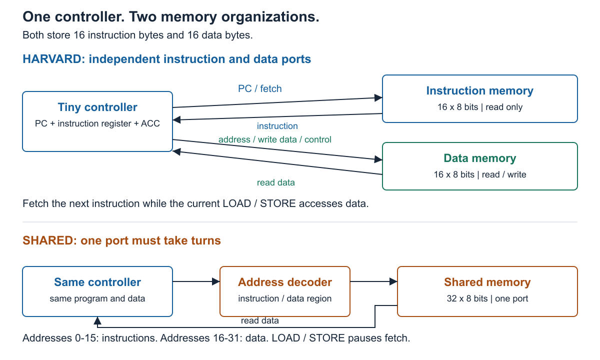
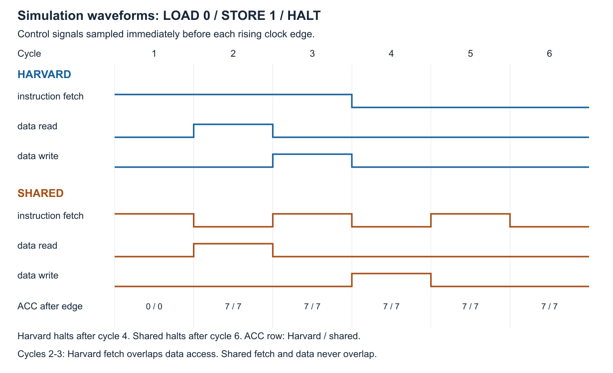

# Architec | Instruction and Data Memory Hierarchy

**MCA Projects 2026 — Section A — Project 9**  
**Team Name:** Architec  
**GitHub Repository:** [TechySuryansh/Architec](https://github.com/TechySuryansh/Architec)  
**Interactive GitHub Pages Site:** [https://TechySuryansh.github.io/Architec](https://TechySuryansh.github.io/Architec)

---

## Team Roster & Ownership

| Member | Enrolment No. | Institutional Email | Project Ownership |
| --- | --- | --- | --- |
| **Suryansh Singh (Lead)** | 2401010467 | `suryansh.singh2024@nst.rishihood.edu.in` | System Integration, IEEE Report, Repository & GitHub Pages Deployment |
| **Pranjal Modi** | 2401010334 | `pranjal.modi2024@nst.rishihood.edu.in` | Instruction Memory, Program Counter, Instruction Fetch Verification |
| **Sarvjeet Yadav** | 2401010424 | `sarvjeet.yadav2024@nst.rishihood.edu.in` | Data Memory, Read/Write Control, Timing & Reset Retention |
| **Abhishek Tripathi** | 2401010022 | `abhishek.tripathi2024@nst.rishihood.edu.in` | Shared Memory, Address Decoder, Port Contention Arbitration |
| **Sameer Khan** | 2401020054 | `sameer.khan2024@nst.rishihood.edu.in` | Testbench Suite, Simulation Verification, Waveforms & Analysis |

---

## Core Demonstration

We demonstrate one primary architectural principle in Verilog:  
**Separate instruction and data paths permit an instruction fetch and a data access to occur concurrently in the same clock cycle, eliminating structural hazards.**

Both memory organizations run the same demonstration program with identical controllers, clock frequency ($10\,\text{ns}$ period), and memory capacity (32 bytes total):

| Harvard Architecture | Shared Single-Port Memory |
| :--- | :--- |
| 16 instruction bytes + 16 data bytes | Unified 32-byte memory |
| Independent instruction and data ports | Instructions and data time-share one physical port |
| **4 cycles to completion** | **6 cycles to completion** |



---

## Quickstart & Simulation

To run the simulation using Icarus Verilog:

```sh
# Run the 3-instruction demonstration
make demo
```

The program contains three instructions:
```text
LOAD 0     ; Read data[0] = 7 into accumulator
STORE 1    ; Write accumulator to data[1]
HALT       ; Terminate execution
```

The terminal prints a cycle-by-cycle trace verifying results:

| Metric | Harvard Architecture | Shared Memory |
| :--- | :---: | :---: |
| **Final `data[1]` value** | **7** | **7** |
| **Total Completion Cycles** | **4** | **6** |
| **Fetch/Data Overlap Cycles** | **2** | **0** |
| **Blocked Fetch Cycles** | **0** | **2** |



---

## Verification Test Suite (6/6 Passing)

```sh
# Run all six verification scenarios
make test
```

The testbench checks:
1. **Scenario 0 (Demo):** `LOAD 0 -> STORE 1 -> HALT` (Harvard: 4 cycles, Shared: 6 cycles).
2. **Scenario 1 (Boundaries):** Upper address boundary (address 15) and back-to-back STORE followed immediately by LOAD.
3. **Scenario 2 (No Data Traffic):** `NOP -> NOP -> HALT` (both finish in 4 cycles; proves Harvard advantage occurs specifically when data accesses compete).
4. **Scenario 3 (Immediate HALT):** Halts cleanly in 2 cycles.
5. **Scenario 4 (Fault Handling):** Invalid opcodes trap and set `fault = 1`.
6. **Scenario 5 (Reset Recovery):** Mid-sequence reset clears controller while retaining written memory data.

---

## Documentation & Project Links

- 🌐 **[Interactive Web Portal (GitHub Pages)](https://TechySuryansh.github.io/Architec)**: Live cycle stepper, architecture visualizer, study materials, and simulator.
- 📘 **[Study Material & Project Guide](docs/PROJECT_GUIDE.md)**: Cycle-by-cycle breakdown, ISA description, module reference, and viva interview Q&A.
- 📋 **[Requirements & Evidence Checklist](docs/REQUIREMENTS.md)**: Deliverable audit against evaluation criteria.
- 👥 **[Team & Submission Plan](docs/TEAM_AND_PLAN.md)**: Member roles, timeline, and submission guidelines.
- 📄 **[Two-Page IEEE Report Draft](output/pdf/Architec_Phase_I_Report_Draft.pdf)** (with editable [LaTeX Source](docs/report/phase1_report.tex)).
- 🎥 **[Video Demonstration Script](docs/VIDEO_SCRIPT.md)**: 3-minute 30-second script for all 5 team members.
- 🎬 **[Demonstration Video (Google Drive)](https://drive.google.com/file/d/1GOwnnic7O2yTTr9AbOawrpZRBdAf3lRN/view?usp=drive_link)** (details & submission checklist in [VIDEO.md](VIDEO.md)).

---

## Generated Artifacts

- `results/demo_output.txt`: Human-readable cycle table for the demonstration.
- `results/demo_trace.csv`: Cycle-by-cycle sampled signals.
- `results/demo.vcd`: Demonstration waveform (open in GTKWave or online VCD viewers).
- `results/test_output.txt`: Comprehensive output of all 6 test scenarios.
- `results/summary.csv`: Machine-readable results summary.
- `docs/figures/`: Vector SVGs and high-resolution PNGs of architecture and waveforms.

---

## Submission Details

- **Course:** MCA Projects 2026, Section A
- **Deadline:** November 16, 2026, 11:59 PM IST
- **Submission Form:** [Google Form Submission](https://docs.google.com/forms/d/e/1FAIpQLSc6Cx8OrOQLGj_X2ZMkyG5jc8mokq36mGRq2x8jGRNV1sbegA/viewform)
